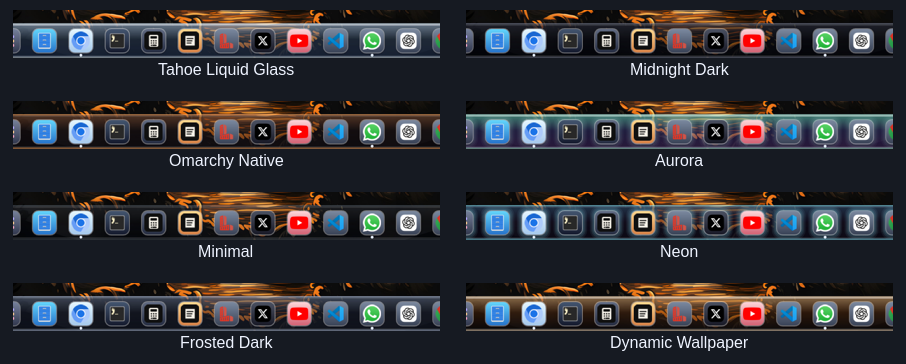
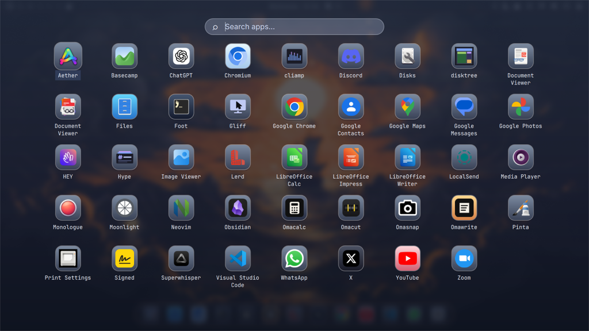
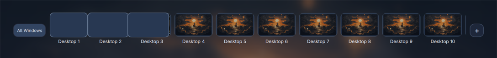
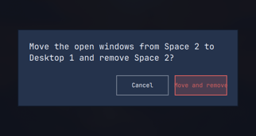

# Glass Dock for Omarchy

A customizable replacement for the Omarchy Quattro dock with glass themes, a full-screen app launcher, and a workspace window overview. It uses the desktop entries, icons, and pinned apps already on your system.



## Install

Tested on Omarchy 4.5.0-3 with Hyprland 0.56.2. ImageMagick is optional for Dynamic Wallpaper color extraction.

```bash
omarchy plugin add https://github.com/arbazajaz/omarchy-glass-dock.git --enable
```

Disable any other dock clone first. This plugin declares itself a clone of the built-in dock so Omarchy can switch between them. If the previous dock stays on screen after enabling it, run `omarchy restart shell`.

## Use

### Dock Settings

Right-click the **nine-dot app launcher icon in the dock** to open Dock Settings. If the dock is hidden, move the pointer to its screen edge first. You can also open settings with `omarchy-shell omarchy.dock settings`. Click a setting to cycle forward or right-click to cycle backward. Theme, size, position, and auto-hide changes apply live.

### Launcher and overview

- Click the nine-dot icon or press **Super+Alt+Space** for the launcher. Type to search and click outside the apps to dismiss it.
- Run `omarchy-shell omarchy.dock overviewOpen` to see open windows grouped by desktop. Select a preview to focus its window. If Hyprland cannot capture a preview, the card shows an app icon.
- A visible dock reserves space in normal use. In fullscreen it reveals at the screen edge and briefly overlays the application without resizing it.



## Optional Hyprland integration

The files under [hypr](hypr/) are opt-in. Back up your configuration and review existing bindings before loading them at the end of `~/.config/hypr/hyprland.lua`. Include only the features you want.

```lua
local glass_dock = os.getenv("HOME") .. "/.config/omarchy/plugins/io.github.arbazajaz.glass-dock/hypr/"
dofile(glass_dock .. "appearance.lua")
dofile(glass_dock .. "spaces.lua")
dofile(glass_dock .. "gestures.lua")
dofile(glass_dock .. "window-management.lua")
```

- **Appearance** enables compositor blur for the dock and overlays, plus a workspace slide animation. The blur radius is a Hyprland compositor setting.
- **Gestures** adds macOS-style four-finger trackpad swipes. Remove any overlapping custom four-finger bindings before loading it.
- **Spaces** adds persistent, dynamically created workspaces to Mission Control. The overview shows Omarchy's numbered workspaces plus any other native desktops, including empty ones. Use the **+** button to create a Space. Drag a window card onto a workspace thumbnail to move it while preserving its window state. Use the **×** on a created Space to remove it; if it has windows, Mission Control asks before moving them to a safe destination. New Spaces are saved across logins. The helper is loaded before gestures because the gestures can navigate to these named Spaces.
- **Window management** updates **Alt+Tab**, raises maximized floating windows on focus, and updates **Super+F** to preserve a displaced maximized window’s geometry. Application-specific fullscreen commands use Hyprland’s native behavior.

Run `hyprctl reload` and `hyprctl configerrors` after editing. Dynamic Wallpaper samples the active local wallpaper while selected and makes no network requests.

### Four-finger trackpad gestures

With `hypr/gestures.lua` loaded:

| Swipe | Action |
| --- | --- |
| Up | Open Mission Control (the window overview) |
| Down | Close Mission Control |
| Left | Switch to the next numbered workspace |
| Right | Switch to the previous numbered workspace |

Horizontal swipes move one workspace at a time, including empty workspaces.

### Mission Control Spaces



Mission Control's top row is a horizontally scrollable Spaces overview. It includes all configured Omarchy workspace slots and native workspaces on the current monitor, not a fixed two- or five-desktop list. The active desktop is outlined. Click a preview to switch to it and filter the window cards below. Drag a card to a thumbnail to move that actual window. **+** creates a persistent named Space; **×** removes one of those created Spaces. When a Space contains windows, confirm the move before removal.



## Remove

Remove any optional `dofile` lines you added and reload Hyprland. Then disable and remove the plugin.

```bash
omarchy plugin disable io.github.arbazajaz.glass-dock
omarchy plugin remove io.github.arbazajaz.glass-dock
```

If needed, re-enable the stock dock with `omarchy plugin enable omarchy.dock`. Your saved dock preferences remain in the Omarchy shell configuration.

## License

MIT. This plugin builds on the MIT-licensed [Omarchy project](https://github.com/omacom/omarchy). The screenshots show the plugin running with Omarchy’s wallpaper and the installed applications’ icons. App marks belong to their respective owners.
